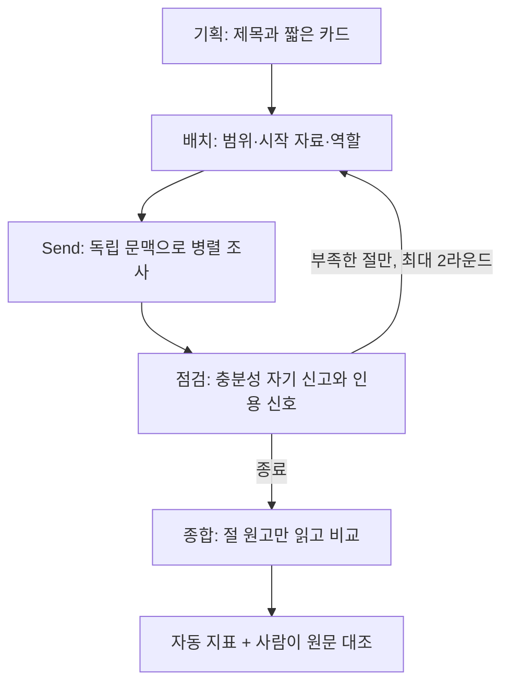

# 위기 아틀라스 · 수업 프로젝트

2020년 코로나 급락기와 2026년 11월 현재의 한국·미국 증시를 조사하는 LangGraph 기반 리서처입니다. 전체 코퍼스를 한 번에 입력하지 않고, 총괄이 내용별로 나눈 담당에게 독립된 문맥을 전달합니다.

**현재는 제작·검토 중입니다. 첫 유료 시험에서 근거 불일치를 발견했고 수정 전 결과를 실패 사례로 보존했습니다. 최종 비교 실험·작성자의 직접 평가·GitHub 제출은 아직 완료하지 않았습니다.**

공개 저장소의 [검토용 브랜치](https://github.com/wilstein91/Project_DeepResearch/tree/codex/official-corpus-review-20261106)에 수정 코드·공식 자료·REPORT.md 초안을 반영했습니다. 기존 main에는 합치지 않았으며 수업에도 제출하지 않았습니다. 현재 필수 파일과 미완료 사항은 output/submission_status.json에 있습니다.

## 1. 데모 열기

현재 컴퓨터에서 실행 중인 데모: [위기 아틀라스](http://127.0.0.1:8507)

다시 실행하려면 PowerShell에서 아래 순서로 입력합니다. `cd`는 작업 폴더를 옮기는 명령이고, `python -m`은 설치한 프로그램을 Python으로 실행하는 방식입니다.

```powershell
cd 'C:\Aiffel_Work\Project Coordination\modulabs-deep-researcher'
python -m pip install -r requirements.txt
python -m streamlit run app.py --server.address 127.0.0.1 --server.port 8507 --server.headless true --browser.gatherUsageStats false
```

실행 후 브라우저에서 위 주소를 엽니다. 이 주소는 이 컴퓨터 안에서만 사용하는 로컬 주소입니다. 기본 실행은 **가짜 응답을 쓰는 무료 구조 점검**입니다. 실제 API 실행 체크박스를 선택한 경우에만 비용이 듭니다.

## 2. 자료와 출처

- 교재 수집 프롬프트: 한국어 위키백과, 시드에서 최대 2홉, 각 3,000자 이상, 연도·목록·분류 제외, 실제 링크만 연결.
- 실제 기본 자료: 위키백과 40건, 439,937자, 687개 연결, 링크 수 중앙값 26, 최소 3,006자.
- 보강: 연준 공개 문서 6건 + 직접 작성한 짧은 관찰·사실 요약 카드 7건.
- 합계: 53건, 557,288자, o200k_base 실제 측정 285,793토큰. gpt-4o-mini의 128,000토큰 입력 한도보다 큽니다.
- 짧은 카드 7건은 3,000자 이상 문서 수에 포함하지 않습니다. 카드만 읽은 것을 원문 전문을 읽은 것으로 주장하지 않습니다.
- 최신 보강에는 11월 6일 재정경제부 긴급 시장상황점검회의와 그 발표에 수록된 미국 11월 5일 동향, 한국은행 10월 22일 정책 여건이 포함됩니다. 발표·시행·관찰 시점을 분리합니다.
- 현재 한국 화면의 시장 기준시각이 명확하지 않아 종가로 사용하지 않습니다. 미국 11월 5일 장중, 10월 월간 배경도 따로 표시합니다.
- 신뢰할 수 있는 기관의 출처인지와 전문 재사용 허용 여부는 별개입니다. AI 활용 금지를 명시한 언론 본문은 코퍼스에 넣지 않았습니다.

원문·메타데이터·통계는 `data/corpus.json`, `data/sources.json`, `data/corpus_stats.json`에 있습니다. 문서별 출처 URL·버전·라이선스와 변경 형태를 보존합니다. 위키백과 텍스트는 [CC BY-SA 4.0](https://creativecommons.org/licenses/by-sa/4.0/)에 따릅니다. 원저작자 이력은 각 문서 URL과 revision_id로 추적합니다. 연준 Board 본문의 재사용 근거는 [공식 안내](https://www.federalreserve.gov/disclaimer.htm)이며 제3자 이미지·동영상은 수집하지 않았습니다.

재수집은 다음 순서입니다. 첫 명령은 인터넷에서 자료를 읽고, 둘째 명령은 보강 카드를 다시 합칩니다. AI 호출은 없습니다.

```powershell
python scripts\collect_corpus.py --target 40 --with-official
python scripts\add_fact_cards.py
```

모델을 바꾸면 실제 입력 한도를 다시 확인해야 합니다. 프로그램의 작은 읽기 예산을 모델 자체의 입력 한도로 취급하지 않습니다. 모델 한도·가격 근거: [OpenAI gpt-4o-mini 문서](https://developers.openai.com/api/docs/models/gpt-4o-mini), 확인일 2026-11-06. 계정 모델 목록에서 사용 가능함을 확인했지만 공식 문서에서는 Deprecated(새 작업에 권장하지 않는 상태)로 표시됩니다.

## 3. 조사 구조



`Send`는 담당별로 서로 다른 입력을 보내 병렬 실행하는 LangGraph 기능입니다. 총괄은 원문 대신 제목·짧은 소개와 최종 절 원고를 봅니다. 조사자는 자기 노트와 이전 원고만 봅니다. 다른 담당의 원문·노트는 넘기지 않습니다. 전역 상태에는 결과가 모이지만 실제 AI 호출 입력을 따로 구성합니다.

읽기 도구는 문서 한 건의 전체 본문을 한 번에 읽고 근거 노트를 만듭니다. 본문을 몰래 자르지 않습니다. 단일 호출이 모델 한도를 넘으면 중단합니다. 링크 이웃과 전체 카드 검색을 모두 사용할 수 있으며 없는 연결은 만들지 않습니다. 새 노트의 인용 구절이 원문에 실제 존재하는지 검사한 뒤, 관련 근거가 있는 노트만 작성 단계로 넘깁니다. 이것도 의미 일치를 보장하지 않으므로 사람의 검토가 필요합니다.

새 절이 미열람 인용을 만들거나 인용 비율·횟수를 낮추면 기존 절을 유지합니다. 이는 인용 보존을 위한 결정 규칙이며 글의 의미상 품질을 자동 보장하지 않습니다. 원래 부족했던 절과 필요한 내용만 재조사하고 최대 라운드에서 종료합니다.

## 4. 실행과 비교

`.env.example`을 참고해 `.env`에 `OPENAI_API_KEY`를 설정합니다. **키를 채팅·스크린샷·GitHub에 올리지 않습니다.** 현재 사용자의 로컬 키는 이미 연결 확인을 마쳤습니다.

```powershell
python run.py
python run.py --question-id Q1 --mode team --live
```

첫 명령은 가짜 응답 점검, 둘째는 실제 유료 실행입니다. 설정의 1회 추정 비용 상한은 $0.10이며 자동 API 재시도는 끕니다. 매 호출 전 입력·최대 출력의 비용을 보수적으로 예약하고 완료 후 실제 사용 토큰으로 추정액을 계산합니다. 네트워크 오류 등으로 사용량을 받지 못하면 공급자 사용량 확인이 필요하며 자동으로 다시 실행하지 않습니다. 가격은 세금·환율·계정별 할인을 반영하지 않은 문서 기준 추정입니다.

8개 질문과 분업 이유는 `data/questions.json`에 있습니다. 정답표는 없습니다. 단일 문서 질문은 담당을 1명으로 줄입니다. 대표 비교 사례는 Q1(코로나·현재 한미), Q4(1997·2008), Q5(SVB 대상 추적)입니다.

비교 설정은 전체 분업 / 단일 조사자 / 시작 자료·타 담당 영역 안내 끄기 / 전문 역할 끄기 / 재조사 끄기입니다. 이름만 바꾸지 않고 실제 입력과 실행 경로를 바꿉니다. 같은 사례 안에서는 모델·코퍼스 해시·도구·담당당 읽기 수·최대 라운드를 고정합니다. 단일 조사자는 팀의 모든 담당·라운드에 허용되는 **최대 총 문서 읽기 횟수**를 순차적으로 모두 소비합니다. 팀이 충분하다고 일찍 끝내면 실제 읽은 양은 달라지므로 둘 다 기록합니다. 동일 최대 예산 비교이며 동일 실제 토큰량 비교는 아닙니다.

```powershell
python ablation.py --cases Q1 Q4 Q5 --repeats 2
```

위 명령은 3사례 × 5설정 × 2회 = 30개의 무료 구조 점검입니다. 가짜 응답으로 확인한 성능 수치를 실제 결과처럼 사용하지 않습니다. 실제 반복 비교는 `--live --max-total-usd 금액`을 명시해야 실행되며, 현재는 사용자와 첫 결과를 검토한 뒤 범위를 정할 예정입니다.

## 5. 지표 읽는 법

| 종류 | 지표 | 해석 |
|---|---|---|
| 반드시 확인할 경보 | 존재하지 않거나 읽지 않은 문서 인용 | 0이어야 함. 절별·전체 검사 |
| 반드시 확인할 경보 | 인용이 전혀 없는 절 | 0이어야 함. 확인 불가만 쓴 절은 예외를 사람이 설명 |
| 기록할 경고 | 원문에 없는 인용 구절 시도 | 노트에서 제거하되 실패 시도를 기록 |
| 비교 신호 | 인용 문장 비율·편중·중복 읽기·읽고 미사용 | 정답률이나 단일 순위가 아님 |
| 자원 | 총괄/조사자 입력 글자 수, 토큰, 호출 수, 비용, 시간 | 실제 보낸 system/user 메시지 문자열 길이. 전송용 JSON 스키마 길이는 별도 글자 수에 포함하지 않음 |
| 사람 판단 | 주장이 원문·시점과 맞는지 | 원문을 나란히 보며 직접 기록 |

정답표와 판정용 AI를 사용하지 않습니다. 첫 시험의 미열람 인용은 0이었지만 잘못된 시대의 자료가 현재 주장을 뒷받침하는 것처럼 쓰여 실패했습니다. [실패 분석](output/PILOT_REVIEW.md)을 참조하세요.

## 6. 점검·제출

```powershell
python -m pytest -q --basetemp=.test-temp-local
```

검증은 병렬 결과 합치기, 다른 담당의 노트 차단, 부족한 절만 재조사, 잘못된 새 원고 보존 방지, 실제 스위치 효과, 틀린 문서명 중단, 단일 조사자의 예산 소비, 수집 페이지 이어받기를 확인합니다.

최종 제출 전에는 실제 반복 결과·직접 판단·데모 캡처를 `REPORT.md`에 채우고 `.env` 제외를 확인한 뒤 GitHub 저장소 URL을 제출합니다. 수업 제출 화면은 제출 후 수정 불가라고 안내하므로 최종 결과를 검토한 후 제출합니다. 현재 GitHub에는 검토 초안이 올라가 있으며 최종 제출은 하지 않았습니다.

교재의 출력 예시와 같은 `output/runs.jsonl`, `output/ablation.json`, `output/reports/`를 만들려면 다음 명령을 실행합니다. 실제 실행을 추가하지 않고 기존 기록을 정리합니다. 실패한 첫 시험은 제출 제외로 표시하고, 실제 반복 비교가 없으면 미실행 상태를 그대로 기록합니다.

```powershell
python scripts\build_submission.py
```

## 파일 안내

| 파일 | 역할 |
|---|---|
| graph.py | 기획·분업·조사·점검·종합·평가 |
| baseline.py | 같은 도구를 쓰는 단일 조사자 |
| ablation.py | 설정별 반복 비교 |
| metrics.py | AI 판정 없이 계산하는 실패 신호 |
| app.py | 로컬 검토 화면 |
| config.json | 모델·범위·읽기 수·비용 설정 |
| data/questions.json | 정답표 없는 8개 질문 |
| output/runs | 실제 유료 실행 기록 |
| output/offline_checks | 명확히 표시한 무료 가짜 응답 점검 |
| LEARNING_GUIDE.md | 단계별 배운 점과 결과물 연결 |
| REPORT.md | 제출 보고서 초안·남은 요건 |
