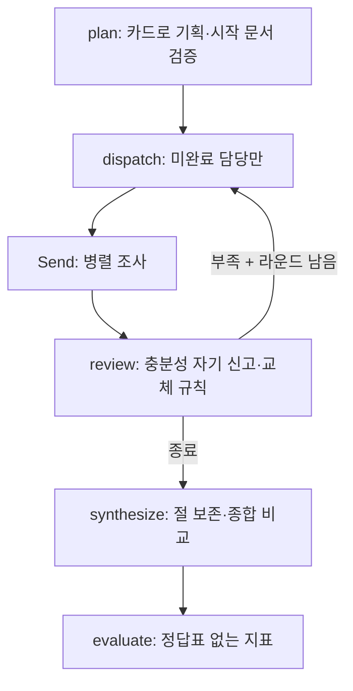

# 위기 아틀라스 — 딥 리서처 프로젝트 보고서 초안

**상태: 제작·검토 중. 최종 제출본 아님.** 실제 첫 시험은 실패 사례로 보존했고, 수정 후 보고서·동일 조건의 반복 실험·작성자 직접 판단·최종 제출이 남아 있습니다.

## 1. 주제와 코퍼스

1900년 이후 금융위기·증시 충격 자료를 모아, 2020년 코로나 급락기와 2026년 11월 5~6일 현재의 한국·미국 증시를 비교합니다. 진행 중인 시장을 확정된 금융위기나 회복기로 단정하지 않고, 관찰·출처 해석·확인하지 못한 내용을 구분하는 것이 질문의 일부입니다.

교재가 제공한 한국어 위키백과 수집 방식으로 40건을 수집했습니다. 각 문서는 3,000자 이상이며, 시드에서 최대 2홉 이내, 실제 코퍼스 내부 링크 687개, 링크 수 중앙값 26입니다. 링크가 없는 기본 문서는 `1998~2002년 아르헨티나 경제 침체`, `주식`입니다. 문서가 고립되어 있다는 사실을 숨기거나 가짜 링크로 메우지 않았습니다.

연준 공식 본문 6건과 직접 작성한 짧은 사실 카드 7건을 보강했습니다. 후자는 원문 전문과 구분하며 3,000자 조건의 기본 문서 수에 포함하지 않습니다. 보강 포함 53건·557,288자이며 실제 o200k_base 측정 285,793토큰으로 gpt-4o-mini의 128,000토큰 한도를 넘습니다. 가격·한도 근거는 [공식 모델 문서](https://developers.openai.com/api/docs/models/gpt-4o-mini)입니다. 모델을 바꾸면 이 조건을 다시 검증합니다.

출처·수집 시점·위키백과 버전·변경 형태·재사용 근거는 data/sources.json에 기록했습니다. 원문 권리 범위가 명확한 위키백과·연준 본문과, 전문을 수록하지 않은 짧은 관찰/요약 카드를 구분합니다. AI 활용 금지 표시가 있던 언론 본문은 제외했습니다.

현재 자료의 한계: KRX 화면 관찰은 시장 기준시각을 확정하지 못해 종가가 아닙니다. NYSE는 미국 11월 5일 오후 장중 해설이고 Nasdaq은 10월 월간 회고입니다. 서로 다른 시간 범위를 일별 종가처럼 비교해서는 안 됩니다.

사용자 선택으로 재시험보다 공식 근거 보강을 먼저 진행했습니다. 재정경제부의 11월 6일 긴급 시장상황점검회의 PDF 2쪽 전체를 확인해 한국의 발표 조치와 시행일을 보강했습니다. 같은 자료 1쪽 각주의 미국 11월 5일 전일 대비 등락률도 별도 사실 카드에 담았습니다. 지수 산출시각·공급자가 명시되지 않아 거래소 종가 원자료를 직접 확보했다고 주장하지 않습니다. 한국은행 10월 22일 통화정책방향은 현재의 정책 여건으로 보강하되 11월 6일 발표로 바꾸지 않습니다. 한국 11월 6일 확정 종가는 여전히 미확보입니다. 이 추가 자료를 반영한 유료 보고서는 아직 실행하지 않았습니다.

## 2. 내용별 분업과 입력 격리

대표 질문의 담당은 사용자가 고른 2020 한국 / 2020 미국 / 현재 한국 / 현재 미국입니다. 서론·본론 같은 글의 형식이 아니라 읽어야 할 시기·시장으로 나눕니다. 담당당 라운드마다 3건, 최대 2라운드입니다.

| 담당 | 수정안의 시작 자료 | 범위 |
|---|---|---|
| 2020 한국 | 2020년 주가 대폭락 | 2020년 2~3월 한국, 사후 설명과 당시 관찰 구분 |
| 2020 미국 | 연준 코로나 충격 대응 발표 | 미국 시장 충격과 당시 정책 |
| 현재 한국 | KRX 공개 화면 관찰 카드 | 관찰 시각과 시장 기준시각 불명확성 명시 |
| 현재 미국 | NYSE 11월 5일 장중 사실 카드 | 미국 거래일·장중과 종가 구분 |

위 시작 자료는 첫 시험 실패 이후의 수정안이며 실제 성능을 검증한 최종 선택은 아닙니다. data/questions.json에는 단일 문서·분산 정보·엔터티 추적 질문 8개와 분업의 필요/불필요 이유가 있으며 정답표는 만들지 않았습니다. 단일 문서 질문은 담당을 1명으로 설정합니다.

총괄은 전체 원문 대신 제목과 250자 소개를 보고 기획합니다. 각 조사자는 자신의 지시·읽은 문서의 노트·이전 원고만 입력받습니다. 다른 조사자의 노트와 원문은 공유하지 않습니다. 종합 단계의 총괄은 절 원고만 읽습니다. 공유 상태에 자료가 있다는 사실과 실제 LLM 호출에 무엇을 넣는지는 구분합니다. 호출별 input_chars는 실제 system/user 메시지 문자열 길이를 재며 JSON 스키마의 전송 길이는 포함하지 않습니다.

## 3. 상태와 흐름

상태에는 question, tasks, pending, round, drafts, selected, log, synthesis, report, metrics, stop_reason이 있습니다. 병렬 조사자가 반환하는 drafts/log는 리스트를 합치는 방식으로 수집합니다. 담당 입력은 Send에 별도로 구성합니다. LangGraph의 기능 근거는 [공식 Send 설명](https://docs.langchain.com/oss/python/langgraph/graph-api#send)입니다.

원문에 존재하는 짧은 근거 구절을 확인하고 관련 노트만 작성 단계로 넘깁니다. 부족한 절은 missing에 적은 필요 근거와 기존 원고를 받습니다. 새 원고의 미열람 인용 또는 인용 보존 신호가 악화하면 기존 원고를 유지합니다. 이 규칙은 의미상 품질 평가가 아니며 재조사·최대 라운드·충분 신고를 로그로 구분합니다.

## 4. 지표와 경보

정답표와 AI 심판을 사용하지 않습니다.

| 구분 | 지표 | 읽는 방법 |
|---|---|---|
| 경보 | 전체·절별 미열람 인용 | 0이어야 함 |
| 경보 | 인용 없는 절 | 0을 기본으로 하되 근거 미확보 절은 사람이 이유 설명 |
| 시도 기록 | 원문에 없는 인용 구절 | 노트에서 제거하고 시도 건수 보존 |
| 비교 | 인용 문장 비율·출처 편중·중복 읽기·읽고 미사용 | 품질 대리 신호이며 정답률 아님 |
| 자원 | 총괄/조사자 입력 글자 수·토큰·호출·비용·시간 | 실제 입력과 사용량으로 기록 |
| 사람 검토 | 문장·원문·시점의 일치 | 보고서를 나란히 보고 판단 |

최종 지표 표와 자동 경보 0건 여부는 수정 후 실제 반복 실험으로 채울 예정입니다. 가짜 응답 구조 점검의 숫자로 순위를 매기지 않습니다.

## 5. 실제 첫 시험에서 발견한 실패

실행: output/runs/20261106T064103-Q1-team.json. 추정 비용 $0.055094, 54회 호출, 입력 308,025토큰·출력 14,817토큰, 읽기 24회. 총괄 입력 21,431자, 조사자 입력 514,501자, 총괄 비중 약 4.00%입니다. 이 수치는 수정 전 시험의 값입니다.

미열람 인용 0건·인용 표시 문장 비율 46.4%였으나, 실제 읽기 기록은 1907년 공황·대공황·석유 파동 등으로 치우쳤습니다. 코로나·최신 자료는 코퍼스에 있었지만 사용하지 못했습니다. ‘현재 한국’ 절은 대공황을 인용하며 현재가 회복 과정이라고 설명했습니다. 원문과 시점에 맞지 않아 제출 불가로 판정합니다.

기획의 잘못된 문서명을 첫 문서로 조용히 대체하는 코드 경로를 없앴습니다. 첫 시험에는 기획 원응답 기록이 없어 원래 제안과 대체 결과의 차이를 확정할 수 없다는 한계도 기록했습니다. 이후 실행은 기획 제안·선택 결과·검증 내용을 남기고, 무관한 문서로 조용히 대체하지 않고 중단합니다. 시작 자료 수정안과 원문 구절 확인도 적용했습니다. 상세 내용은 output/PILOT_REVIEW.md에 있습니다.

## 6. 직접 비교 실험 — 실행 전 계획

같은 모델·코퍼스 해시·도구·최대 총 읽기 예산을 고정하고 전체 분업과 단일 조사자를 비교합니다. 단일 조사자는 최대 예산을 전부 순차 소비합니다. 팀은 충분 신고 시 일찍 멈출 수 있으므로 실제 읽기 횟수·실제 토큰 사용량도 함께 제시합니다. 같은 최대 예산이지 같은 실제 토큰량을 맞춘 실험은 아닙니다.

시작 자료·타 담당 영역 안내 / 전문 역할 / 부분 재조사를 하나씩 끄는 실제 경로가 있습니다. 대표 3사례(Q1·Q4·Q5) × 5설정 × 2반복을 계획했습니다. 무료 구조 점검 30건은 완료했으며, 실제 반복 실험은 첫 결과를 검토하고 비용 범위를 정한 후 실행합니다. 단일 모델의 소수 사례 결과를 모든 질문에 일반화하지 않습니다.

| 항목 | 현재 상태 |
|---|---|
| 수집·출처·실제 토큰 검사 | 완료 |
| 기획→병렬 조사→점검→종합→평가 | 구조 점검 완료, 수정 후 실제 결과 대기 |
| 단일 조사자의 동일 최대 예산 소비 | 무료 구조 점검으로 확인 |
| 스위치별 실제 경로 변화 | 테스트 확인 |
| 대표 3사례×2회 실제 반복 비교 | 미실행 |
| 작성자의 나란히 비교·원문 확인·판단 | 대기 |
| GitHub URL·수업 제출 | 미완료 |

기존 공개 GitHub 저장소는 https://github.com/wilstein91/Project_DeepResearch 입니다. 앞선 코드가 있으나 이 작업 폴더의 수정본과 REPORT.md는 아직 반영하지 않았습니다. 교재의 제출 파일 구성과 같은 output/runs.jsonl·ablation.json·reports/를 생성했고, output/submission_status.json에 필수 파일 존재와 미완료 실험·제출 상태를 구분했습니다. 파일이 존재한다는 사실을 루브릭 충족 완료로 취급하지 않습니다.

## 7. 데모와 재현

app.py의 Streamlit 화면에서 질문·설정 선택, 보고서 나란히 보기, 담당별 읽은 자료·부족 신고·실제 호출 기록·원문 대조를 확인합니다. 사용자 추가 의견과 직접 판단을 별도로 기록하는 칸이 있습니다. 실제 실행은 기본 해제이고 비용 없는 구조 점검이 기본입니다. 실행 방법은 README.md에 있습니다.

크롬에서 무료 실행 버튼으로 전체 흐름을 실행해 결과 선택이 새 파일로 바뀌고 비용 $0.00000·가짜 응답 표시가 나오는 것을 확인했습니다. 추가 의견과 학습 안내 탭도 확인했습니다. 이는 데모 동작 증거이며 실제 보고서 품질 증거는 아닙니다.

## 8. 배운 점과 작성자 소감

학습 포인트는 자료를 많이 넣는 것이 아니라, 질문에 맞게 나누고 실제 입력을 격리하며, 부족한 부분만 다시 읽고, 자동 지표의 한계를 원문 검토로 보완하는 것입니다. 첫 실패는 ‘인용 표시가 존재함’과 ‘인용이 주장을 뒷받침함’이 다르다는 점을 드러냈습니다. 단계별 설명과 결과물 전체 점검은 LEARNING_GUIDE.md에 모았습니다.

**작성자의 직접 소감·최종 설정 선택 이유는 아직 입력하지 않았습니다.** 직접 비교를 본 후 본인의 말로 추가합니다. AI가 작성자의 경험이나 판단을 대신 만들어 넣지 않습니다.
