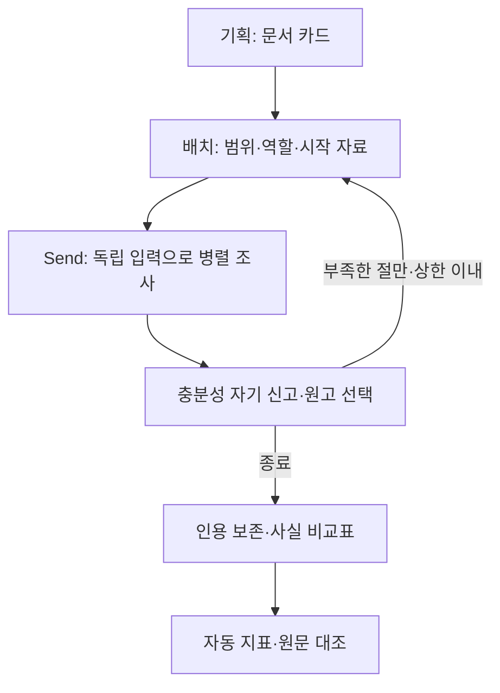
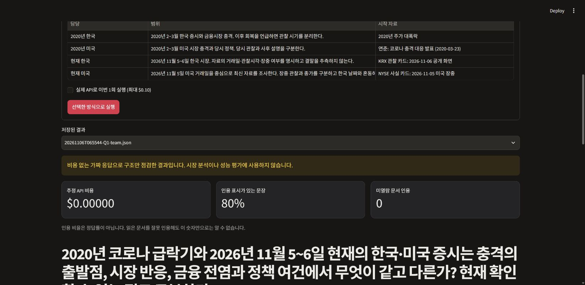
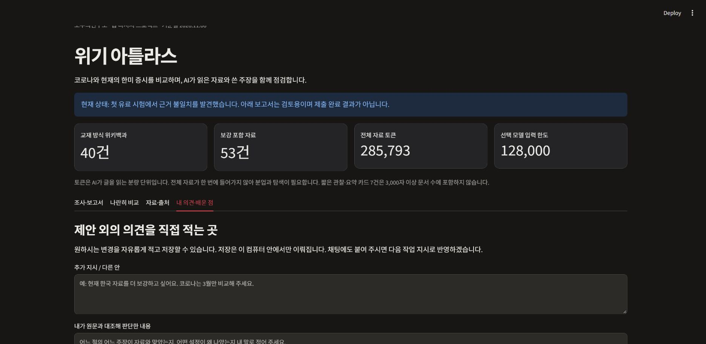

# 금융위기·증시 충격 딥리서처

상태: 실제 비교 20/20회와 작성자의 직접 평가를 기록했습니다. 수업 사이트의 제출 버튼은 누르지 않았습니다.

**직접 평가의 결론:** 조사·인용 기능은 구현했지만 최신 자료의 깊이와 근거를 연결하는 분석이 부족해, 기대한 심층 보고서보다 사실 요약에 가까웠습니다. 실행 지표의 충족과 결과물의 유용성은 별도로 평가해야 하며, 이번 결과로 분업 방식의 우수성을 주장하지 않습니다.

## 1. 주제와 코퍼스

1900년 이후 금융위기와 증시 충격을 모아 2020년 코로나 급락기와 2026년 11월 5~6일의 한국·미국을 비교합니다. 교재의 한국어 위키백과 수집 방식(2홉 이내, 30건 이상, 각 3,000자 이상, 실제 링크, API 이어받기)을 기본으로 했습니다.

기본 위키백과 40건, 최소 3,006자, 687개 실제 내부 링크입니다. 공식 연준 본문 6건과 직접 작성한 짧은 사실 카드 8건을 보강해 전체 54건·557,711자입니다. 짧은 카드는 기본 3,000자 문서 수에 포함하지 않습니다. 실제 o200k_base 측정 286,067토큰으로 gpt-4o-mini의 128,000토큰 한도를 넘습니다. [모델 한도·가격 근거](https://developers.openai.com/api/docs/models/gpt-4o-mini).

코로나 시기의 한국은행 정책·국회예산정책처 사후 분석, 현재의 정부 발표·거래소 관찰·미국 장중 해설을 구분합니다. 관찰일·거래일·발표일·사후 분석을 혼동하지 않습니다. 출처 URL·버전·라이선스·변경 형태는 data/sources.json에 있습니다. 위키백과는 CC BY-SA 4.0, 연준 Board 본문은 공식 재사용 안내를 따릅니다. 다른 자료는 짧은 직접 작성 요약이며 원문 전문·이미지를 넣지 않았습니다.

## 2. 분업 설계

사용자가 고른 기간×시장 네 구역: 2020 한국 / 2020 미국 / 현재 한국 / 현재 미국입니다. config.json에 범위·역할·시작 자료·작성 근거 영역을 두었습니다. 총괄은 문서 카드만 보고, 조사자는 자기 자료·노트만 봅니다. 근거가 부족한 절만 최대 2라운드 안에서 추가 조사합니다. 인용 보존 신호가 악화하면 기존 원고를 유지합니다.

8개 질문과 분업의 필요·불필요 이유는 data/questions.json에 있고 정답표는 없습니다. 실제 반복 대표 사례는 Q1(네 구역 분산 비교)과 Q2(1907년 공황 단일 문서)입니다. Q2는 담당 1명으로 두어 나눌 필요가 작은 질문도 검토했습니다.

대표 Q1의 자료 구역에는 사람이 정리한 출발 자료와 허용 근거 목록을 적용했습니다. 따라서 이 실험은 순수하게 AI 수만 바꾼 비교가 아닙니다. 자료 배정 스위치는 시작 자료·타 담당 회피·작성 근거 범위를 함께 끕니다. 그 하위 요소의 효과까지 따로 분리하지 못한 한계가 있습니다.

## 3. 상태와 흐름

State에는 question, tasks, pending, round, drafts, selected, log, synthesis, report, metrics가 있습니다. Send에 담당별 입력을 따로 담고 drafts/log는 리스트를 합쳐 수집합니다. 실제 메시지 글자 수를 총괄과 조사자별로 따로 기록합니다. 원문을 몰래 자르지 않습니다.

문서 선택은 실제 후보의 제한된 형식으로 받고, 원문에 실제 존재하는 구절만 근거로 남깁니다. 작성 AI는 근거 번호를 선택하며 문서명 인용은 프로그램이 붙입니다. 종합은 각 절의 문장을 보존한 비교표로 만듭니다. 인용 형식과 실제 의미 일치는 별개여서 원문 대조가 필요합니다.

## 4. 지표와 실제 비교

정답표·AI 심판을 사용하지 않습니다. 미열람/존재하지 않는 인용과 인용 없는 절은 경보로 확인합니다. 인용 문장 비율·편중·중복 읽기·읽고 미사용·입력 글자 수·실제 토큰·호출·비용은 비교 신호입니다. 인용 비율은 정답률이 아닙니다.

같은 모델·코퍼스 해시·도구·최대 읽기 예산으로 전체 분업, 단일 조사자, 자료 배정 끄기, 역할 끄기, 추가 조사 끄기를 두 질문에서 각각 2회 반복합니다. 단일 조사자는 총 최대 읽기 예산을 실제로 모두 소비합니다. 팀이 먼저 끝내면 실제 읽기량은 다르므로 함께 기록합니다. 동일 최대 예산이지 동일 실제 토큰 수를 맞춘 비교는 아닙니다.

실제 반복 비교 20회의 추정 비용은 $0.396380입니다. 초기 시험·중단·작성 교정과 비교 성과에서 제외한 추가 작성 시험 $0.023874를 합친 알려진 전체 추정액은 $0.551945입니다. 추가 작성 시험을 기존 20회 비교 결과나 개선 성과에 섞지 않았습니다. 비용은 공급자 청구서가 아닌 실제 사용 토큰과 일부 중단 기록을 바탕으로 한 추정입니다.

| 질문 | 설정 | 반복 수 | 평균 비용($) | 평균 실제 읽기 | 인용 문장 비율 | 미열람 인용 |
|---|---|---:|---:|---:|---:|---:|
| Q1 | 단일 조사자 | 2 | 0.06561 | 24.0 | 76.4% | 0 |
| Q1 | 자료 배정 끄기 | 2 | 0.03179 | 12.0 | 88.6% | 0 |
| Q1 | 추가 조사 끄기 | 2 | 0.00967 | 10.0 | 87.5% | 0 |
| Q1 | 전문 역할 끄기 | 2 | 0.00985 | 10.0 | 87.7% | 0 |
| Q1 | 전체 분업 | 2 | 0.00975 | 10.0 | 87.9% | 0 |
| Q2 | 단일 조사자 | 2 | 0.01691 | 6.0 | 0.0% | 0 |
| Q2 | 자료 배정 끄기 | 2 | 0.01817 | 4.5 | 31.2% | 0 |
| Q2 | 추가 조사 끄기 | 2 | 0.00860 | 3.0 | 0.0% | 0 |
| Q2 | 전문 역할 끄기 | 2 | 0.01215 | 4.5 | 27.3% | 0 |
| Q2 | 전체 분업 | 2 | 0.01570 | 6.0 | 0.0% | 0 |

이 표는 자동 순위표가 아닙니다. 반복 2회·대표 사례 2개라는 작은 범위이므로 모든 질문에 일반화할 수 없습니다. 실행 원문과 상세 기록은 output/runs, 집계는 output/ablation.json, 직접 나란히 읽는 자료는 output/reports/COMPARE_Q1_FIRST_PAIR.md에 있습니다. 가짜 응답 점검은 실제 성능 집계에서 제외했습니다.

## 5. 실패를 절·자료까지 추적

- 첫 시험: 현재 한국 절이 대공황을 인용하며 현재 회복을 주장했습니다. 미열람 인용 0이어도 의미가 틀릴 수 있었습니다. 실패 원본과 분석을 output/PILOT_REVIEW.md에 보존했습니다.
- 문서 선택: 목록에 없는 이름을 반환하면 조용히 첫 문서로 바꾸던 경로를 없애고 실제 후보 형식으로 제한했습니다. 중단과 비용 기록도 남깁니다.
- 현재 미국 절: 2023년 SVB를 현재 원인으로 가져온 원고를 발견해 시기·자료 영역을 분리했습니다.
- 종합: 연준 통화정책을 재정정책으로 쓰거나 정부의 설명을 확정 원인으로 바꾸는 추론이 나왔습니다. 절의 인용 문장을 보존한 비교표로 바꿨습니다.
- 원문 자체: 위키백과의 2020-02-20~04-07을 ‘약 한 달’이라 한 표현은 날짜 간격 47일과 맞지 않습니다. 인용이 원문과 같다는 사실만으로 정확성이 보장되지 않습니다. 원본을 보존하고 검토용 편집본에서는 이 상대기간 표현을 제외합니다.

## 6. 데모와 재현

app.py의 로컬 Streamlit 화면에서 질문·설정, 보고서 나란히 보기, 담당별 읽기·원고·부족 신고·호출 기록·원문을 확인합니다. 추가 의견과 직접 평가를 적는 칸도 있습니다. 실행 방법은 README.md에 있으며 기본은 비용 없는 구조 점검, 실제 API는 명시적으로 선택합니다. 코드 점검 9개를 통과했고, 크롬에서 무료 실행 결과의 저장과 화면 표시를 확인했습니다.

## 7. 프로젝트 회고와 배운 점

이번 구현에서 가장 공들인 부분은 자료 수집 규칙, 실제 입력 격리, 잘못된 문서 선택 차단, 근거 구절과 인용의 연결입니다. 초기에는 데모·부가 문서와 실패한 작성 수정에 시간을 많이 써 진행 관리가 미흡했습니다. 개선 과제는 원문 자체의 날짜·수치 검증, 자유 추론의 과장 방지, 자료 배정의 세부 효과 분리입니다.

보고서 품질의 한계를 구현까지 추적하면, 담당별 작성 지시가 사실 4~7개를 요구하고 종합이 사실 보존 비교표로 끝나는 구조였다는 점이 드러납니다. 잘못된 추론을 줄이는 장치는 있었으나, 출처를 연결해 원인·전달 경로·정책 차이를 논증하는 단계는 부족했습니다. A·B의 현재 미국 절을 보면 A에는 정부 발표의 일별 등락률이 있고 B는 NYSE 장중 관측에 머무르지만, 어느 쪽도 이 차이만으로 심층 분석의 우수성을 입증하지 못합니다. 해당 절과 자료를 보존하고 한계로 기록했습니다. 분석 작성 개선은 후속 과제이며 효과를 검증했다고 쓰지 않습니다.

Q2 일부 실행에서는 원문과 일치하는 관련 근거 구절을 확보하지 못했습니다. 문서 읽기 횟수와 유효한 근거 확보는 다릅니다. 부족 신고 역시 실패 분석 대상이며, 근거가 없는 내용을 채워 성공으로 처리하지 않았습니다.

수업에서 확인할 핵심은 자료의 실제 분량 확인 → 내용별 분업 → 독립 입력 → 부족한 절만 재조사 → 같은 조건 비교 → 사람이 원문과 대조하는 순서입니다. 앞선 7개 노드와의 연결 및 전체 결과물에서 배운 점은 LEARNING_GUIDE.md에 모았습니다.

### 작성자의 직접 비교 평가

자료를 수집하고 담당별로 나누어 읽은 뒤 출처를 연결하는 기능은 구현되었지만, 제시된 결과물은 기대한 심층 분석 보고서보다 사실 요약의 모음에 가까웠다. 특히 최근 시장 자료의 범위와 깊이가 부족해, 코로나 시기와 현재의 차이를 충분히 설명하기 어려웠다. 수치와 정책을 제시하는 데서 더 나아가 충격의 원인, 한미 시장의 연결 관계, 정책 대응의 차이와 시사점을 하나의 논리로 종합하는 기능이 부족했다.

따라서 인용 비율·읽기 횟수·비용 같은 실행 지표만으로 보고서 품질이나 분업 방식의 우수성을 판단할 수 없었다. 후속 개선에서는 신뢰할 수 있는 최신 자료를 시점별로 보강하고, 확인된 사실과 분석적 추론을 구분하면서 근거를 결론으로 연결하는 종합 작성 단계를 개선할 필요가 있다. 이번 평가는 어느 설정의 승리를 선언하기보다, 구현된 조사 기능과 사용자가 기대한 보고서 품질 사이의 차이를 확인한 데 의미가 있다.

위 문단은 작성자가 제공한 비판의 취지를 개발 프로젝트 형식으로 정리한 것입니다. 작성자가 A·B의 우열을 선택했거나 수정본에 만족했다고 해석하지 않습니다. 개선 방향은 후속 과제이며, 개선 효과가 검증됐다는 뜻이 아닙니다.
